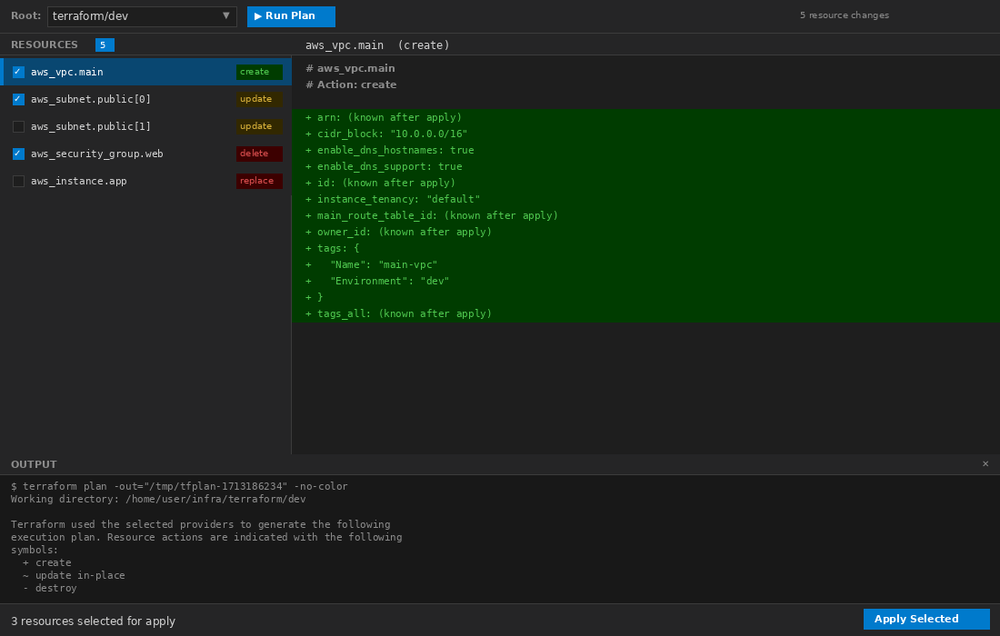

# Terraform UI — VSCode Extension

A visual diff tool for Terraform plan changes with targeted apply support.



## Features

- **Visual Plan Diff**: Run `terraform plan` and see all resource changes in a split-pane UI
- **Resource List**: Left panel shows all resources to be changed with action badges (create/update/delete/replace)
- **Diff Viewer**: Click any resource to see its attribute-level diff on the right panel
- **Targeted Apply**: Select specific resources with checkboxes and apply only those changes using `-target`
- **Live Terminal Output**: See real-time `terraform` command output in the bottom panel when private environment overrides are not configured
- **CLI Confirmation**: Type "yes" to confirm apply, just like the standard Terraform CLI
- **Auto-Detection**: Automatically finds all Terraform roots in your workspace

## Usage

1. Open a workspace containing Terraform files (`.tf`)
2. Open the Command Palette (`Ctrl+Shift+P` / `Cmd+Shift+P`)
3. Type **"Terraform UI"** and select it
4. Or right-click a folder/`.tf` file in the Explorer and select **"Terraform UI"**

### Workflow

1. Select a Terraform root from the dropdown
2. If needed, enter Init arguments (for example `-reconfigure -backend-config=apply.tfvars`) and click **Init**, then click **▶ Run Plan** to execute `terraform plan`
3. Review resources in the left panel — click any to see detailed diff
4. Check the resources you want to apply
5. Click **Apply Selected** at the bottom
6. Type `yes` in the confirmation prompt and press Enter

### Init arguments and privacy

Init runs in the selected root without a shell. Enter a visible single-line argument string, not JSON: `-reconfigure -backend-config=apply.tfvars`. The [shlex lexer](https://github.com/rgov/node-shlex) splits whitespace and handles POSIX-style single/double quotes and backslash escapes; for example `-backend-config="env/dev backend.hcl" -plugin-dir '/tools/plugin dir'`. Use `''` or `""` for an empty argument. Variables, command substitutions, globs, operators and comments are not evaluated or expanded; quote any argument containing spaces, including `'$(command with spaces)'`. Backslashes outside quotes escape the next character: single-quote Windows paths, for example `-backend-config='C:\config files\apply.tfvars'`, or double each backslash. ANSI-C `$'…'` quoting supports escaped control characters such as `\n`; unclosed quotes, dangling escapes, raw newlines and NUL are rejected without saving or starting a process. Do not enter a complete command. Input/output controls, directory overrides, help/version flags, and `-force-copy` are rejected; Init always uses `-input=false -no-color`. Configure credentials through backend-supported environment variables where possible.

**Save arguments** and successful **Init** remember the current root's argument array in VS Code SecretStorage, scoped by extension-host storage installation and root folder. A nonsecret random namespace is kept in the extension's private, file-backed storage directory on that host, isolating local and remote hosts even when their root paths match. Native local desktop `vscode-userdata:` storage uses VS Code's [local filesystem mapping](https://github.com/microsoft/vscode/blob/1.96.0/src/vs/platform/userData/common/fileUserDataProvider.ts); remote hosts require their own authority-free `file:` storage. Browser storage, foreign authorities, and arbitrary URI schemes are not treated as host-local paths. Init argument loading/saving fails closed if this storage is unavailable; legacy unnamespaced arguments are not loaded. Clearing this host storage loses the reference to previously saved arguments (it does not delete the old SecretStorage entries or expose them to another host). The input is visible, including any credentials you enter: protect your screen and prefer environment credentials. Existing saved arrays reopen as readable quoted arguments without changing their values; persistence remains an array, not a command string. Unsaved edits and canceled/failed Init runs do not replace saved arguments. Cross-root suggestions contain only combinations of these exact flags: `-upgrade`, `-reconfigure`, `-backend=false`, `-get=false`, `-lock=false`. Arguments containing paths, backend configuration, or other values never enter suggestion history or ordinary extension settings.

Init output and raw errors are withheld because backend diagnostics can echo credentials. Terraform CLI argument/logging environment overrides are removed for Init. Arguments are still visible to operating-system process inspection, and Terraform itself can write backend configuration to `.terraform`; SecretStorage does not protect Terraform's files. Use a secure terminal for diagnostics and do not put credentials in shared backend files.

All operations require workspace trust. Only one Terraform process runs at a time across Terraform UI panels. **Cancel operation** requests termination and waits for the process to exit; it does not roll back Terraform's work. Run a fresh plan after Init. Init can download providers/modules and configure backend state; review arguments before running it.

### Execution settings and credentials

Terraform UI spawns processes on the **extension host**. It inherits that host's environment, not exports from an integrated terminal, `direnv`, shell aliases, or shell startup files. Changing or resetting a terminal does not update the running extension host's inherited environment. No terminal environment is automatically captured and no rc file is sourced.

Select a root and click **Execution settings**. Native VS Code inputs configure:

- A visibly readable literal executable name (default `terraform`) or **absolute path**, including paths with spaces. Do not quote the path or add arguments. Bare names resolve using the execution environment's `PATH`. A selected wrapper is executable code: trust and review it yourself; the extension never adds a shell.
- A JSON object of explicit environment overrides, for example `{"GOOGLE_APPLICATION_CREDENTIALS":"/private/account.json","HTTPS_PROXY":"http://proxy.example:8080","UNWANTED_VARIABLE":null}`. String values override inherited variables, `null` removes them, and an empty string remains empty. Choose **Edit environment masked** (the first option) to keep saved and typed values hidden, or explicitly choose **Reveal and edit environment visibly** to read and edit the complete JSON object. Environment values may contain secrets: visible editing reveals existing saved values as well as new typing, so use it only in private. Saved environment values are not revealed by default. Values are literal, without `$VAR` expansion. Use `{}` to reset overrides and `terraform` to reset the executable. Canceling any input or the visibility choice saves neither the staged executable nor environment changes.

Both executable and overrides are stored together in SecretStorage using the same private host/root namespace as Init arguments, never ordinary workspace settings, webview messages, logs, or cross-root suggestion history. Configure each root and execution host separately; remote paths, executables and credential files must exist on the remote extension host, not merely the local client. Unavailable private host storage or SecretStorage blocks execution rather than silently falling back. Clearing private host storage loses the references to saved settings. The executable and credential files themselves remain your responsibility; SecretStorage protects saved values, not process environments, files or provider caches.

Plan and its Show subprocess use one executable/environment snapshot. Init and Apply use the same settings mechanism. All operations require workspace trust; settings are not imported from repository-controlled VS Code configuration. Terraform CLI argument, input, automation and logging environment overrides are reserved: explicit overrides are rejected, inherited `TF_CLI_ARGS*`, `TF_LOG*`, `TF_INPUT` and `TF_IN_AUTOMATION` controls are removed, and the extension sets its automation/noninteractive controls. Review a fresh plan after changing settings.

With any environment overrides configured (including removals), raw Plan/Show/Apply output is withheld to avoid credential echoes, even across output chunks. Apply still exposes a fixed confirmation prompt. Diagnostics report the operation and default/custom executable without paths or environment values; raw process and JSON parse errors are withheld. Exact configured nonempty string values are masked in structured plan strings/attribute keys, and matching numeric attribute values are masked. Masking is display-only and can redact coincidental matches, especially short values. Each displayed row has an opaque plan-scoped selection ID; Apply resolves it to the original address on the host, never to redacted display text. Actions and resource mode are not redacted. Apply requires the same root and saved executable/environment settings used by that plan; changes from another panel or window require a fresh plan. A failed/new plan or attempted Apply invalidates previous selections. This is not a guarantee against provider-encoded, transformed, or file-derived secrets: inspect only trusted plans and use a secure terminal for detailed diagnostics. Without overrides, normal live provider output remains visible and can contain inherited credentials; Init output is always withheld. These settings provide explicit environment control, not automatic discovery or diagnosis of authentication failures.

### Multiline diffs

Multiline strings and templates use a display-only heredoc with line-by-line additions, removals, and unchanged context. JSON objects also retain line context. Every physical line is classified, including create/delete and values becoming unknown. HTML and template expressions remain literal text. Heredoc markers avoid collisions with content; a missing final newline is marked explicitly. In multiline strings, carriage returns are shown as `\r` and literal backslashes as `\\`, so CRLF and literal backslash-r remain distinguishable. This view is not executable HCL. Very large unrelated values fall back to full removal/addition rather than an expensive fine-grained diff.

### Open the terminal's current folder

For typed **`tfui`** or **`terraform-ui`** commands in POSIX integrated terminals:

1. In a trusted desktop VS Code workspace, run **Terraform UI: Enable tfui / terraform-ui in New Terminals** from the Command Palette and confirm.
2. Create a **new** integrated terminal after enabling. Existing terminals are not modified.
3. `cd` to a workspace directory containing `.tf` files, then type `tfui` or `terraform-ui`. The launcher reads its actual process current directory; shell integration is not required. The exact folder is selected in multi-root workspaces. User arguments are ignored; this only opens the UI, never runs Terraform.

The extension writes two executable helpers in its own global storage directory, and its nonpersistent [environmentVariableCollection](https://code.visualstudio.com/api/references/vscode-api#EnvironmentVariableCollection) prepends that directory to PATH **only for newly created integrated terminal processes in this window**. This shadows executables with the same names in those terminals; existing shell aliases/functions can still take precedence. It changes neither your global PATH nor shell startup files. Mutations explicitly disable application through shell-integration scripts: no commands are injected into an existing prompt. Enable again and create a new terminal after an extension/window reload; old terminals retain stale environment values and cannot use the old token. Disposing the extension clears its collection; helper files can remain inert in extension storage.

The fixed `/bin/sh` wrapper uses quoted environment variables to run the bundled launcher with the extension host runtime (`ELECTRON_RUN_AS_NODE=1` for the desktop Electron executable, or the remote Node runtime). The launcher invokes the existing desktop `code --open-url` CLI (`code-insiders` in Insiders), or the remote integrated-terminal CLI's `--openExternal` route with separate arguments and **no shell**, passing a per-activation token and canonical base64url-encoded cwd. The CLI must already be installed and available on terminal PATH. The helper does not install VS Code, Node, or a global executable. Storage paths containing `:` cannot be represented as POSIX PATH entries and are rejected.

Both typing routes resolve their callback with VS Code's [asExternalUri](https://code.visualstudio.com/api/references/vscode-api#env.asExternalUri) in the owning extension host. This preserves VS Code's window-routing metadata, so another focused window does not steal the callback. Only the exact session-minted routing fields are accepted; missing, changed, duplicate, or additional fields are rejected. URI handling requires workspace trust, exact extension scheme/authority/route/token, a literal absolute cwd inside an open workspace root, and Terraform files directly in that directory. Only roots on this workspace extension host's filesystem are eligible. The launcher resolves symlinks in both the process cwd and eligible roots before checking physical containment, then selects the folder using the opened workspace root's spelling. Links escaping all workspace roots are rejected. When using F5, the terminal folder must belong to the **Extension Development Host child window's workspace**, not just the source/debugger parent; open or add the folder in that child window. VS Code transforms remote workspace URIs into host-local `file:` URIs; UI-side remote or foreign authorities are never substituted for the launcher process's cwd. Caller-supplied host overrides are not accepted. This token is routing protection, not a security boundary against processes running as your OS user.

The extension runs on the workspace host for Remote SSH/Containers/WSL. The launcher is designed for **POSIX extension hosts** (including a Linux remote host from a Windows client), with a matching terminal and an existing VS Code CLI capable of URL delivery. A manually SSH-connected terminal on another host is not supported. Native Windows extension hosts have no automatic PATH launcher: use the PowerShell session fallback below. Browser-only VS Code is unsupported. Desktop and remote terminals must use the matching VS Code CLI and preserve its normal extension-URL consent flow.

#### Keyboard command and existing-terminal fallback

Use **Terraform UI: Open from Terminal Folder**, or **Ctrl+Alt+Shift+T** (**Cmd+Alt+Shift+T** on macOS) while the integrated terminal has focus. This fallback requires VS Code shell integration to report the current directory. It does not execute shell commands. If current-directory reporting is unavailable or reports a foreign/UI-local URI, open the folder from the Explorer or use the process-cwd typing route above. VS Code 1.96 can report an ambiguous `vscode-local:` cwd remotely; the keyboard command and PowerShell fallback reject that URI rather than guessing its host.

For an existing integrated **bash/zsh** or **PowerShell (pwsh)** terminal, the older **Terraform UI: Enable tfui in This Terminal** command remains an explicit fallback. Choose the shell actually running and confirm only at a clean, idle prompt with no pending input: this fallback uses shell integration to define/replace a session-only `tfui` function and can interrupt a running command. On a POSIX remote workspace host, the bash/zsh function uses the bundled runtime to read its actual process cwd and the matching remote CLI; it does not reinterpret a UI-side `vscode-local:` URI as a remote path. Elsewhere, the function uses the original terminal's shell-integration cwd and the existing VS Code CLI. It does not install PATH helpers or capture terminal environment settings. Closing that terminal or reloading the extension invalidates its token. The primary new-terminal launcher above does not use this shell-function mechanism.

If typing a shortcut returns to the prompt without opening a panel, first check VS Code for the normal extension-URL **Open** consent dialog or a Terraform UI warning. An invalid/stale shortcut reports how to enable it again. New callbacks target their originating window; URLs from older extension versions or stale sessions must be regenerated, not copied between windows. For the session-function fallback, enable again in that same terminal after a reload; for the PATH launcher, enable again and create a new terminal. A successful CLI exit confirms only URL dispatch, not panel delivery. If no dialog or warning reaches VS Code, verify that `code` (`code-insiders` for Insiders) on that terminal's PATH belongs to the same local installation or remote server; the extension cannot diagnose a URL that never reaches its handler. Do not share the function definition, launcher environment, or raw URI when troubleshooting: they contain a routing token. **Terraform UI: Open from Terminal Folder** bypasses CLI/protocol delivery and can help distinguish it from current-folder/shell-integration problems.

The protocol route is also illustrated in Microsoft's [protocol-handler test plan](https://github.com/microsoft/vscode/issues/48427). The [official CLI documentation](https://code.visualstudio.com/docs/configure/command-line) provides no general arbitrary-extension-command switch; both typing routes use desktop `--open-url` or remote `--openExternal` and the registered extension URI handler. **VS Code 1.96.0 is the minimum for both typing routes**: the remote CLI in [1.93.0](https://github.com/microsoft/vscode/blob/1.93.0/src/vs/server/node/server.cli.ts) through [1.95.3](https://github.com/microsoft/vscode/blob/1.95.3/src/vs/server/node/server.cli.ts) recognizes only `http://`, `https://`, and `file://` URLs in `openInBrowser`, converting extension URLs into file paths. [1.96.0](https://github.com/microsoft/vscode/blob/1.96.0/src/vs/server/node/server.cli.ts) recognizes the `vscode://` and `vscode-insiders://` schemes and preserves their routes and query parameters. The remote CLI does not support desktop `--open-url`; use the matching VS Code remote server and its integrated-terminal CLI, not a stale CLI from another installation.

## Requirements

- **VS Code 1.96.0 or newer** (remote CLI extension-URL delivery and terminal shell integration API)
- **Terraform CLI** must be installed and available in your `PATH`
- Initialize each root with **Init** or `terraform init` before running a plan

## Development

```bash
cd misc/vscode-terraform-ui
docker compose up -d app
docker compose exec app npm ci
docker compose exec app npm run check
docker compose exec app npm test
```

`npm ci` applies the version-pinned shlex dependency patch in `patches/` through `tools/patch-shlex.cjs`, using the existing `diff` dependency with exact original/patched source integrity checks. `compile` and `watch` also explicitly verify/apply it, including after CI installs with `--ignore-scripts`; packaging and publication run `compile` before collecting runtime files. The patch confines escape decoding to the current quoted fragment so adjoining quoted fragments cannot reinterpret literal backslashes from an earlier fragment. The VSIX includes the patched runtime lexer and its license, not the development patch tooling.

`npm test` compiles and discovers `tests/*.test.cjs` through Node’s test runner. It uses mocked Terraform processes and a jsdom webview DOM, plus real Linux shell execution of the terminal helpers against a stub VS Code CLI. Both typing routes also exercise source-derived remote URL transformations for 1.93.0/1.95.3 (file-path failure) and 1.96.0 (extension-URL delivery); these offline contract tests do not run a complete VS Code server or replace desktop smoke testing. The packaging regression uses a private copy of installed dependencies to verify compile and real VSIX contents with lifecycle scripts bypassed, without publishing. The suite never runs Terraform.

To test in VS Code: Press `F5` in VSCode to launch Extension Development Host.

## Release

### Prerequisites

- `vsce` CLI (installed as devDependency via `@vscode/vsce`)
- VS Code Marketplace PAT ([Azure DevOps](https://dev.azure.com/signageos/_usersSettings/tokens) → Marketplace: Manage scope)
- Open VSX token ([open-vsx.org](https://open-vsx.org) → User Settings → Access Tokens)

### Manual Release

1. Update `CHANGELOG.md` — rename `[Unreleased]` to `[X.Y.Z]`, add fresh `[Unreleased]` above
2. Bump version:
   ```bash
   npm version X.Y.Z --no-git-tag-version
   ```
3. Build and package:
   ```bash
   npm run vscode:prepublish
   npm run vscode:package
   ```
4. Publish to both marketplaces (tokens from encrypted `.env`):
   ```bash
   npm run vscode:publish
   ```
   Or individually:
   ```bash
   npm run vsce:publish
   npm run ovsx:publish
   ```
5. Commit, tag, and push:
   ```bash
   git add package.json package-lock.json CHANGELOG.md
   git commit -m "Bump X.Y.Z"
   git tag -a "vX.Y.Z" -m "Release vX.Y.Z"
   git push origin master && git push origin "vX.Y.Z"
   ```

### GitLab CI Release

The `.gitlab-ci.yml` pipeline automates publishing:

1. **Every push**: `build` job compiles and packages the `.vsix`
2. **Manual on default branch**: `release:tag` creates a git tag from the current `package.json` version
3. **On tag push**: `publish:vsce` and `publish:ovsx` publish to both marketplaces
4. **On tag push**: `release:notes` creates a GitLab release

**Required CI/CD variables:**
| Variable | Description |
|----------|-------------|
| `CI_REPOSITORY_PUSH_USERNAME` | GitLab username with push rights (for tagging) |
| `CI_REPOSITORY_PUSH_TOKEN` | GitLab token with push rights (for tagging) |

**Tokens in encrypted `.env`** (decrypted via SOPS at publish time):
| Variable | Description |
|----------|-------------|
| `VSCE_PAT` | VS Code Marketplace Personal Access Token |
| `OVSX_TOKEN` | Open VSX Registry access token |
